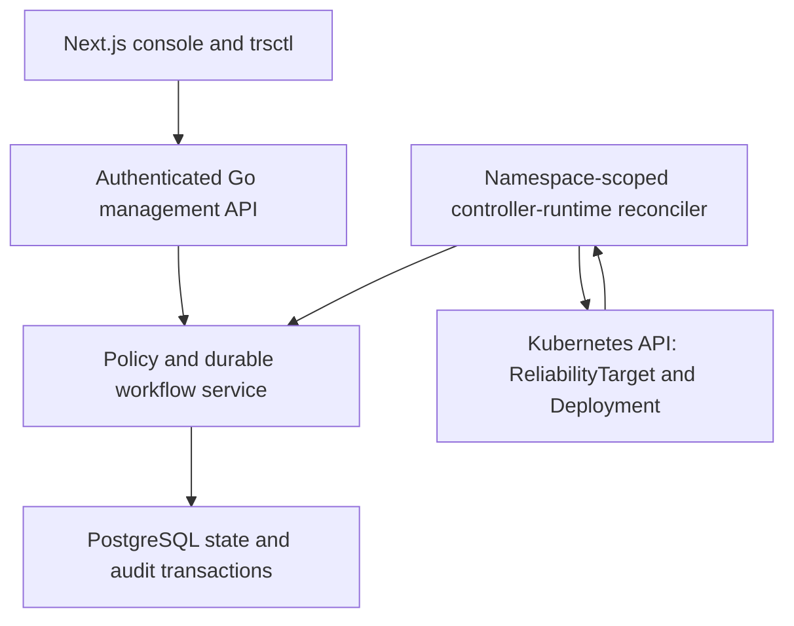
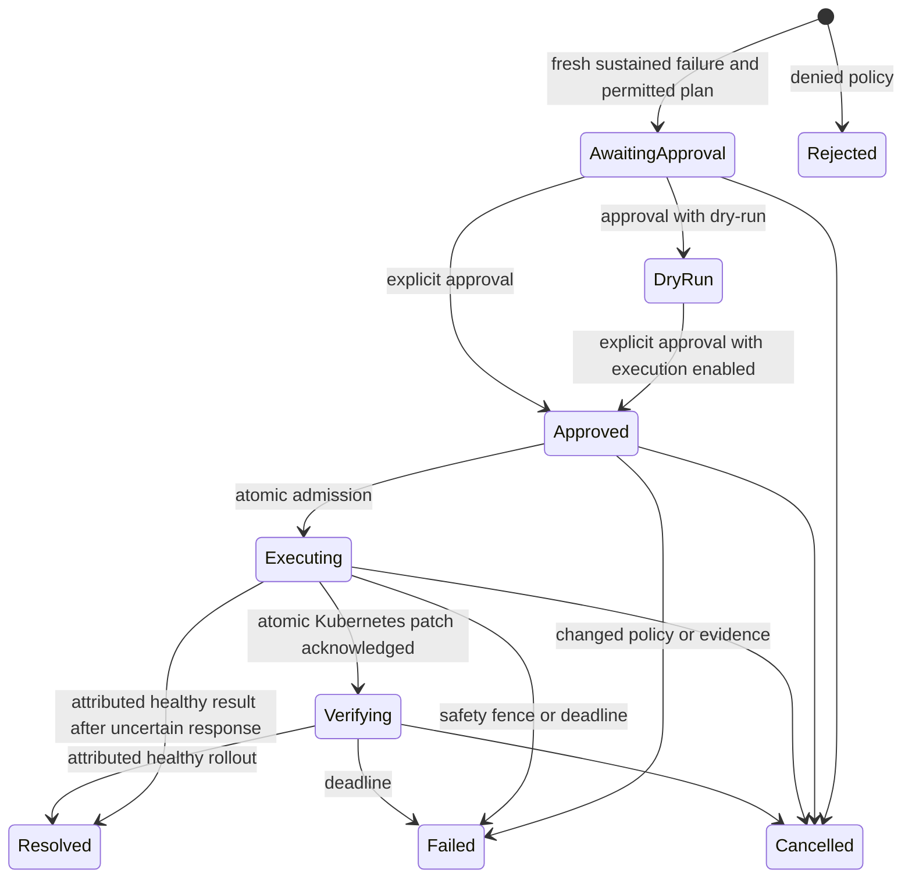

# Architecture

TargetReconciliationService is an early control-plane implementation. The current executable slice handles one local cluster; multi-cloud and multi-cluster are target architecture, not demonstrated capacity.

## Boundaries

The management process optionally runs a Kubernetes reconciler with leader election. HTTP exposes registration, policy, approval, cancellation, bounded audit pagination and a read snapshot. Observation and execution methods are internal; external clients cannot submit an observation, choose an execution key, mark verification successful, or call an arbitrary Kubernetes operation through HTTP. The Next.js server forwards read requests to a configured backend. Its browser token exists only in component memory.

The initial command client has snapshot, audit, register, policy, approve, cancel. Production OIDC, users, multi-tenancy and outbound managed-cluster agents are not implemented. Local operator and viewer tokens represent two development principals with server-assigned roles.

## Domain and reconciliation

A cluster has a test-only environment and observation heartbeat. A ReliabilityTarget names one Deployment container and a digest-pinned operator-declared recovery image. The controller reads actual Kubernetes Deployment identity, generation, desired/available/updated replica counts, opt-in and ownership metadata. This is deployment health evidence, not application request health or CPU utilization.

An unready rollout must remain unready across fresh observations for the configured detection window. A telemetry gap restarts that window. A healthy workload clears its failure episode. Incidents are deduplicated per target episode. Ordinary same-image failures do not create executable restart proposals: Kubernetes retains ordinary healing responsibility.

The deterministic plan records evidence, action, namespace/cluster scope, reasoning, approval, verification, and abort semantics. Its known-good image is declared by a trusted operator, not inferred or certified by TargetReconciliationService. Approval checks current policy and evidence again. Default dry-run records the decision without executable admission. After disabling dry-run, an explicit second approval of a DryRun incident is necessary.

Investigating and Planned stages are currently synchronous evaluation within detection, not separate persisted states. Incident timeout is evaluated on Claim when a successful observation permits reconciliation; an outage can leave historical Executing status visible past its deadline. Stale evidence still prevents a later mutation. There is no independent timeout sweeper yet.

## Transaction and mutation semantics

PostgreSQL serializes state updates with one JSONB aggregate row lock. Audit appends are mirrored into relational `rp_audit` in the same transaction; existing entries cannot change through the repository, and SQL triggers reject update/delete/truncate on the audit table. Strong consistency covers policy, approval, admission and audit per transaction. Kubernetes state is eventually consistent; execution necessarily happens after commit and is not part of a distributed SQL/Kubernetes transaction.

The admitted incident ID is the execution idempotency key. Execution first validates immutable UID, approved generation, replicas, container, original image, opt-in and absence of recognized GitOps ownership. The API server atomically tests a freshly read resourceVersion, UID and source image, replaces only the selected image, and sets a pod-template execution annotation. Routine status updates therefore do not permanently invalidate approval. A write error may be an acknowledged-but-lost response: the same key is retained, and a matching marker/image prevents repeating the rollout. Other spec changes fence the action. Retries are controller-runtime workqueue retries plus a two-minute workflow deadline, not an exactly-once distributed execution guarantee.

Verification requires the same deployment UID, expected image and execution marker, current observed generation, and sufficient updated and available replicas. No synthetic success is produced when Kubernetes is unavailable. Cancellation and emergency stop block future admission; neither can retract a Kubernetes HTTP request already in flight. Target deletion, CRD deletion or API outage cannot be equated with health.

## Backpressure and scale

The API admits at most 32 concurrent requests, has a shared 20 requests/second token bucket with burst 100, 16KiB request bodies, deadlines and socket timeouts. PG uses at most 8 connections. Admission has a policy concurrency cap (1 default, max10). Controller workqueues use established rate-limited retry behavior. Namespace scoping bounds the watched domain. Inventory limits are100 clusters,1000 observed targets and 10000 incidents; these are admission limits, not tested cluster capacity. Audit retains all entries; snapshot returns the last 200 and `/v1/audit` pages at most 200 by sequence.

The whole-state JSON aggregate is a deliberate correctness-first limitation. Reads and writes copy the entire retained aggregate, including audit history. HTTP output bounds do not bound database read cost. Before larger deployment, normalize per-tenant/target tables, add retention and archival, use per-target locks/leases, partition controllers, build an outbox and durable event consumers, add per-principal quotas, and measure PostgreSQL and actual cluster throughput. Leader election alone does not make this an enterprise HA system.

## Future event architecture

PostgreSQL remains source of truth. A transactional outbox will publish versioned immutable events to NATS JetStream; consumers use explicit acknowledgements, bounded redelivery, deduplication and a dead-letter workflow. Per-target order and optimistic versions must be checked by consumers. No event bus is needed or claimed operational in this initial slice. See ADRs and ROADMAP.

## CRD conditions in TRS 0.2

ReliabilityTarget uses Kubernetes' status subresource and condition conventions. Status observedGeneration identifies the CR spec version evaluated, distinct from the observed Deployment generation. Ready reports rollout readiness; Reconciled reports whether the controller pass completed successfully, not whether an operator authorized remediation. Unknown Deployment reads do not become healthy when the status endpoint remains writable. If the entire API server is unreachable, no controller can persist a new condition; backend telemetry freshness remains the authority for staleness. Conditions retain lastTransitionTime when their truth value is unchanged and are only patched when status changes; generation predicates avoid status-induced event loops while periodic polling continues. The CRD schema and scoped Role explicitly expose status permissions.

Rollout health requires observedGeneration at least the Deployment's current generation, total replicas equal to desired, updated replicas equal to desired, and enough available replicas. This is deliberately stricter than aggregate availability: an old healthy replica plus an unready new replica must not satisfy recovery verification. It is still Deployment-level evidence, not request-level application health.
