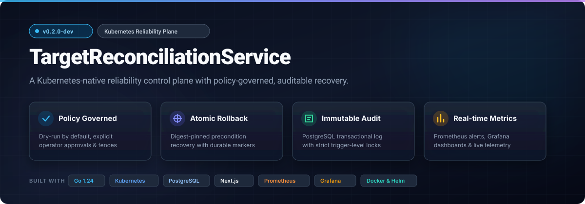
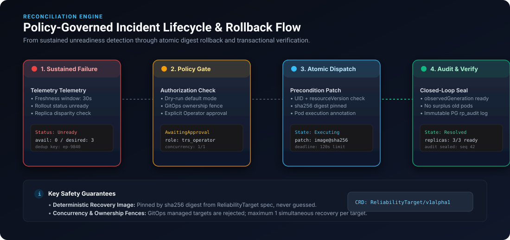
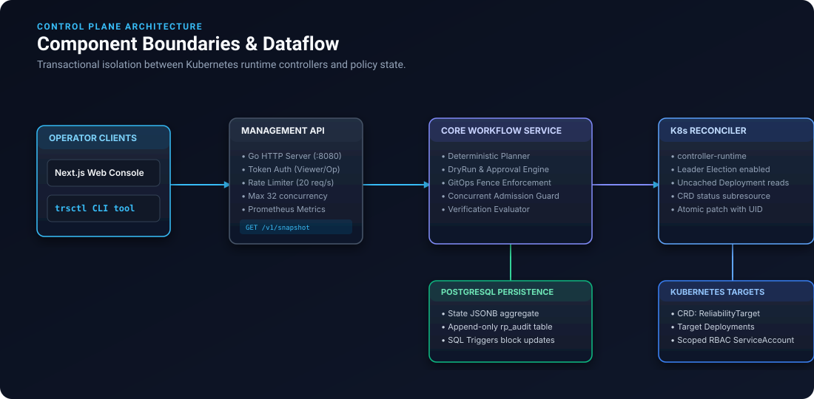
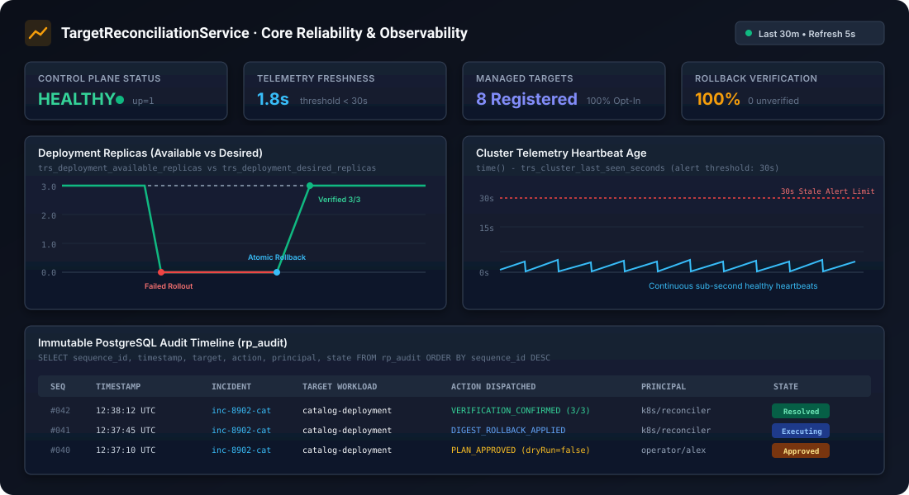

# TargetReconciliationService

<p align="center">
  
</p>

<p align="center">
  <a href="https://github.com/ATLURI0001/target-reconciliation-service/actions"></a>
  <a href="go.mod"></a>
  <a href="config/crd/reliabilitytargets.yaml"></a>
  <a href="internal/store/migrations/001_initial.sql"></a>
  <a href="web"></a>
  <a href="observability"></a>
  <a href="LICENSE"></a>
</p>

---

TargetReconciliationService coordinates observation, incident detection, proposed recovery, authorization, execution and verification. It addresses the gap between deployment failure signals and accountable operational intervention: who approved the change, what evidence justified it, what actually changed, and whether the selected target recovered.

**Status: 0.2.0-dev laboratory implementation.** This is working control-plane software with automated integration evidence, not a production-ready multi-cloud platform. The selected name does not imply exclusive availability; see docs/research.md. No adoption or demonstrated enterprise-scale claim is made.

## What works now

- Go management API and CLI with distinct local viewer/operator identities.
- PostgreSQL-backed cluster records, observations, policy, incidents and transactional audit timeline. No in-memory fallback in the executable.
- A real controller-runtime reconciler and validated namespaced ReliabilityTarget CRD with generation-aware Ready/Reconciled status conditions; uncached Kubernetes observation, leader election, scoped RBAC and safe retry behavior.
- Sustained fresh-failure detection, deterministic explainable rollback proposals, dry-run by default, explicit approval, opt-in and GitOps ownership fences, per-target/concurrent admission, cancellation and deadline checks.
- Digest-pinned image rollback using atomic UID/resourceVersion/image preconditions and a durable execution marker. Verification binds the original target/container/replica count to observed rollout readiness.
- Read-only Next.js/TypeScript/Tailwind console for actual clusters, workload health, incidents/plans, policy and audit; explicit loading/error/empty/stale states.
- Real API metrics; optional Prometheus/Grafana configuration, alert tests, Docker/Compose, Helm chart, Jenkins validation pipeline and local-lab commands.

The original product logic is the transactional policy/admission/workflow model and its Kubernetes execution/verification bridge. Kubernetes still schedules/heals workloads, PostgreSQL owns persistence, and future GitOps changes belong to GitOps controllers.

## Workflow & Rollback Lifecycle

The control plane implements an end-to-end, policy-governed state machine: from fresh sustained failure detection through deterministic rollback proposal, operator authorization, atomic digest execution, and closed-loop replica verification.

<p align="center">
  
</p>

## Architecture

TargetReconciliationService maintains strict transactional isolation between Kubernetes runtime controllers and policy state.

<p align="center">
  
</p>

Read [ARCHITECTURE.md](ARCHITECTURE.md) for consistency, replay, dispatch and scale boundaries. The current bridge watches one local test namespace; outbound agents and multi-cluster operations are planned.

## Metrics & Observability

TargetReconciliationService exposes real-time Prometheus metrics (`/metrics`) and includes a pre-configured Grafana dashboard for telemetry freshness, replica convergence, and immutable audit logs.

<p align="center">
  
</p>

- **Telemetry Freshness**: Alert fires when `time() - trs_cluster_last_seen_seconds > 30s`.
- **Replica Convergence**: Tracks `trs_deployment_available_replicas` against `trs_deployment_desired_replicas`.
- **Audit Stream**: Real-time event timeline mirrored directly from the PostgreSQL `rp_audit` append-only table.

See [observability/README.md](observability/README.md) for Prometheus configuration and alert verification rules.

## Changes in 0.2.0-dev

The project is now **TargetReconciliationService (TRS)**. Repository, Go module, executable, `trsctl`, chart, Docker image, `TRS_` configuration, `trs_*` metrics, namespace and API group are updated consistently. See [rename and migration boundaries](docs/rename-migration.md) before reusing an older installation.

[GitHub Actions CI](.github/workflows/ci.yml) is configured for pushes and pull requests. It runs the build/test/lint/Helm checks and includes a Docker/Kind live-lab job. The workflow is source-complete but has not been triggered on GitHub in this workspace. Local checks and the actual Docker startup blocker are recorded in the verification report; no green hosted-CI run is invented.

ReliabilityTarget now has a status subresource with `observedGeneration`, `Ready` and `Reconciled` conditions. The controller avoids unnecessary status writes and treats unavailable live reads as unknown health. Rollout verification also requires no old/surplus replicas, so a surviving old Pod cannot mask a failed new release.

## Quick start

Prerequisites: Linux/macOS or Windows WSL2, Git, Go 1.27.4+, Python3, Docker with Compose v2. Console additionally needs Node 22.13+ and npm. Local Kubernetes demonstration additionally needs Kind and kubectl; chart checks need Helm 3. Installation references and missing-tool checks: `make doctor`.

```sh
make doctor
make init
make up
make smoke
```

This starts the Go API and PostgreSQL with loopback ports and resource limits. Compose intentionally has Kubernetes access disabled. The private ignored `.env` contains random development tokens; never share or commit it. Default telemetry is empty until a trusted controller observes a registered cluster.

For the console:

```sh
cd web
npm ci
npm run build
npm start
```

Open http://127.0.0.1:3000 and enter the private TRS_VIEWER_TOKEN from your local `.env`. Its backend defaults to API 8080. The console stores the token only in component memory. It does not show invented infrastructure data.

## Local recovery demonstration

Follow docs/local-lab.md to create the named disposable Kind cluster, apply the CRD/sample Deployment, start PostgreSQL, and run the host Go manager with TRS_KUBERNETES=true. Once the catalog workload is actually healthy, in another terminal:

```sh
TRS_DEMO_EXECUTE=yes ./scripts/demo.sh
```

This explicit test-only command captures a healthy runtime image digest, introduces a failed rollout, verifies a denied viewer approval, approves recovery, and checks the resulting rollout and persistent audit timeline. It refuses other kubecontexts. See docs/scenarios.md for abort, verification, limitations and reset instructions. Live Kind execution has not been demonstrated in the provided environment; the actual control-plane integration tests are separately recorded.

## Testing

```sh
make build
make test
make race
make lint
make helm
# These require a dedicated disposable PostgreSQL database:
TEST_DATABASE_URL='your-isolated-database-url' make integration
# Starts actual kube-apiserver/etcd test processes, with no kubelets:
make envtest
TEST_DATABASE_URL='your-isolated-database-url' make envtest
# Requires built binaries; optional built console integration:
TEST_DATABASE_URL='your-isolated-database-url' TRS_TEST_CONSOLE=1 python3 tests/http_smoke.py
```

Absent PostgreSQL or envtest assets cause explicit integration skips in ordinary `make test`; that is not a successful integration run. `make integration` refuses missing database configuration. Console checks: `npm test`, `npm run typecheck`, `npm run build` inside web/. Prometheus rule tests and additional evidence are documented in observability/README.md and docs/verification.md.

## Integration status

| Technology | Current role/status |
|---|---|
| Git / GitHub | Local history, community assets and push/PR Actions workflow; no remote publication or hosted run |
| Kubernetes | Real CRD/controller, scoped authorization and actual API-server integration tests |
| PostgreSQL | Real persistence, concurrent transaction tests and backup/restore check |
| Docker / Helm | Runtime packaging and local configuration; Helm lint/render passed; Docker runtime unverified |
| Jenkins | Validation/scanning/build/SBOM pipeline supplied; execution and publication unverified |
| Prometheus / Grafana | Real metric endpoint, optional provisioning, validated alert rules; container/UI integration unverified |
| Terraform / Ansible / Argo CD / ELK | Planned functional milestones, not represented by empty integration scaffolds |
| NATS / OpenTelemetry / OIDC | Planned durable events, tracing and production identity; absent from current runtime |

See docs/integrations.md for all 12 requested DevOps technologies and their intended testable roles.

## Security and limitations

Test environments only; default dry-run; deny-by-default local roles. Protected namespace, opt-in, freshness, image identity, ownership, concurrency and approval checks precede dispatch. API clients cannot inject health or call execution/verification endpoints. Cancellation/emergency stop cannot retract an in-flight Kubernetes HTTP request. Known GitOps metadata is rejected; operators must assure exclusive ownership.

Local tokens are not production identity. OIDC/mTLS, tenant isolation, production TLS, image signature verification, normalized scalable storage, retention/archival and external tamper-resistant audit are incomplete. The host development process inherits kubeconfig rights. Keep it private and use a disposable context. Read SECURITY.md and docs/threat-model.md before running.

The PostgreSQL JSON aggregate deliberately serializes writes and grows with retained audit; this is not a large-scale database design. The prototype has no outbound agent, two-cluster failover, cloud modules, actual billing, application request SLO evaluation, ELK ingestion or OTel traces. Envtest supplies rollout status explicitly: no pod scheduling, application recovery or RTO is implied. See implementation-status.json and docs/verification.md for implemented, partial, planned and blocked deliverables.

## Development and contribution

ROADMAP.md prioritizes a live one-cluster demonstration before breadth. CONTRIBUTING.md describes checks and focused contribution opportunities. Changes to execution authority need tests and threat-model review. Issues, support and private security-reporting instructions are in .github/, SUPPORT.md and SECURITY.md. No fabricated maintainers, customers or production deployments are listed.

Original source is Apache-2.0; external components retain their licenses. NOTICE and docs/release.md record remaining dependency/image attribution and release gates. Nothing is published automatically. Local shutdown: `make down`; named Kind teardown: `make kind-down`. Database volumes are preserved by default.
